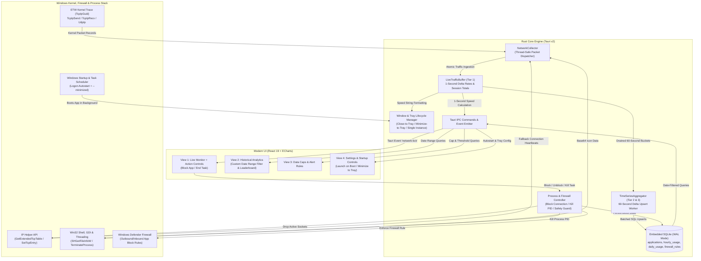

# Project Documentation — Modern PC Network Usage Monitor

A complete technical record, architectural overview, and **Phase 2 Feature Expansion Blueprint** of the **Modern PC Network Usage Monitor**, built with **Tauri v2 (Rust Backend) + React 19 + Tailwind CSS + Apache ECharts**.

---

## 1. Executive Summary & Core Mission
The goal of this application is to run quietly in the Windows background (using under **$15\text{ MB}$ of RAM**), track **100% of device network traffic** (both user applications and Windows system processes like `System` PID 4 and `svchost.exe`), store **45 days of rich historical analytics** in a compact local SQLite database (**$<5\text{ MB}$**), provide a dark-mode dashboard with live system tray integration, and empower users with **active process control** (per-app firewall blocking and instant task termination).

---

## 2. Technical Stack & Dependencies

### Backend (Rust / Tauri v2 Core)
- **Framework:** [Tauri v2](https://v2.tauri.app/) (`tauri = "2"`) with system tray, single-instance lock, autostart, and window lifecycle management.
- **Autostart & CLI Integration:** `tauri-plugin-autostart = "2"`, `tauri-plugin-single-instance = "2"`.
- **Kernel Network Interception:** `ferrisetw = "1.2.0"` for real-time Windows Kernel ETW (`Microsoft-Windows-Kernel-Network` / `TcpIp`).
- **Process Resolution & System Telemetry:** `sysinfo = "0.31"` for process tree enumeration.
- **Win32 Platform Integration:** `windows = "0.58"`:
  * `Win32_Security` (`OpenProcessToken`, `TokenElevation`) for UAC privilege detection.
  * `Win32_UI_Shell` (`SHGetFileInfoW`, `ShellExecuteW`) for icon extraction and admin relaunching.
  * `Win32_Graphics_Gdi` (`GetDIBits`, `DrawIconEx`) for icon rendering to memory.
  * `Win32_NetworkManagement_IpHelper` (`GetExtendedTcpTable`, `GetExtendedUdpTable`, `SetTcpEntry`) for unprivileged connection polling fallback and instant active TCP connection termination.
  * `Win32_System_Threading` (`OpenProcess`, `TerminateProcess`, `PROCESS_TERMINATE`) for ending active tasks safely.
  * `Win32_NetworkManagement_WindowsFirewall` (`INetFwPolicy2`, `INetFwRule`) / Windows Defender Firewall integration for per-application network blocking.
- **Embedded Storage:** `rusqlite = "0.31"` with bundled SQLite and WAL mode.
- **Concurrency & Safety:** `parking_lot = "0.12"` (`RwLock`, `Mutex`).

### Frontend (React 19 + Tailwind CSS + Vite)
- **View Engine:** React 19 + TypeScript.
- **Bundler & Tooling:** Vite 8.
- **Styling & Theme:** Tailwind CSS 3.4 with custom obsidian dark theme tokens (`#080c14`), glassmorphism panels, and cyan (`#06b6d4`) / emerald (`#10b981`) / crimson (`#ef4444`) neon accents.
- **Data Visualization:** Apache ECharts (`echarts`, `echarts-for-react`) for high-FPS 60-second scrolling real-time area charts, custom date-range stacked bar charts, and donut breakdowns.
- **Icons:** `lucide-react`.

---

## 3. Architecture & Data Flow (Updated for Phase 2)



---

## 4. 3-Tier Rolling Data Pipeline & SQLite Schema

Logging every raw network packet to disk would produce gigabytes of data and exhaust system resources. Instead, a **3-tier aggregation model** is used:

### Tier 1: In-Memory Live RAM Buffer (1-Second Resolution)
- Kept in memory only (`parking_lot::RwLock<HashMap<u32, ProcessTrafficCounter>>`).
- Calculates instant upload and download speeds in bytes/second without disk writes.
- Powers the 60-second scrolling area chart, active app table, and system tray tooltip.

### Tier 2: Hourly Buckets (Flushed Every 60 Seconds)
- Every 60 seconds, the background aggregator drains the accumulated minute buffer.
- Persists into the `hourly_usage` table in SQLite using SQL `ON CONFLICT DO UPDATE`.
- Retains peak-hour network activity profiles across the day and powers sub-day custom date/time filtering.

### Tier 3: Daily Summary Rollup (45-Day Retention)
- Stores daily totals per application in `daily_usage`.
- An automatic pruning query runs once every 24 hours:
  ```sql
  DELETE FROM hourly_usage WHERE hour_timestamp < datetime('now', '-45 days');
  DELETE FROM daily_usage WHERE usage_date < date('now', '-45 days');
  ```
- Even with 200 distinct applications over 45 days, the database contains fewer than $10,000$ rows, guaranteeing the database file stays **under $5\text{ MB}$**.

---

## 5. Security & Windows UAC Elevation Architecture

- **Kernel Privilege Requirement:** Windows Kernel ETW sessions and Windows Firewall rule modifications require Administrator privileges.
- **Dual-Mode Operation:**
  1. **Elevated (Admin Mode):** Starts full `KernelTrace` with `TCP_IP_PROVIDER`, subscribing to kernel-level TCP/IP & UDP send/receive events, and enables **Firewall Connection Blocking** and **Elevated Process Termination**.
  2. **Unprivileged (Standard Mode):** Runs without crashing. Uses `GetExtendedTcpTable` / `GetExtendedUdpTable` to identify active processes transmitting data and allows terminating standard user-level processes. Displays an in-app banner with a **"Restart as Administrator"** button.
- **One-Click Elevation Relaunch:** Clicking "Restart as Administrator" executes `ShellExecuteW(..., "runas", ...)` with the application executable path, prompting the Windows UAC confirmation dialog and relaunching elevated.

---

## 6. Phase 1: Implemented Core Components

| Component | File Path | Description |
| :--- | :--- | :--- |
| **ETW Collector** | `src-tauri/src/monitor/etw.rs` | Windows Kernel ETW trace listener with fallback connection scanner and UAC elevation relauncher. |
| **Process Resolver** | `src-tauri/src/monitor/process_info.rs` | Resolves PIDs to process metadata, detects Windows OS services, and extracts Win32 executable icons. |
| **Live Buffer** | `src-tauri/src/monitor/buffer.rs` | Thread-safe live traffic buffer tracking 1-second instantaneous rates and session metrics. |
| **SQLite Schema** | `src-tauri/src/db/schema.rs` | Database path resolution in `%APPDATA%\NetworkUsageMonitor` and WAL mode initialization. |
| **Repository** | `src-tauri/src/db/repository.rs` | Analytical queries, daily/hourly upserts, top consumer rankings, and 45-day pruning. |
| **Aggregator** | `src-tauri/src/db/aggregator.rs` | 60-second background worker persisting deltas into SQLite and running daily cleanups. |
| **System Tray** | `src-tauri/src/tray.rs` | System tray icon with live speed tooltip updates (`↓ 14.2 MB/s  ↑ 1.8 MB/s`) and context menu. |
| **IPC Commands** | `src-tauri/src/commands/mod.rs` | Tauri commands for live metrics, analytics, app profiles, data caps, and elevation. |
| **Live Dashboard** | `src/components/live/` | Speed metric cards, 60-second scrolling dual area chart, and active process table with search. |
| **45-Day Analytics** | `src/components/analytics/` | Daily stacked bar chart, OS vs App donut breakdown, and top consumer leaderboard. |
| **Data Caps & Alerts** | `src/components/caps/DataCapCard.tsx` | Monthly quota progress bar, 80% threshold warnings, and sudden bandwidth spike alerts. |
| **Settings & Engine** | `src/components/settings/SettingsView.tsx` | Storage architecture metrics, database path inspection, and kernel elevation controls. |

---

## 7. Phase 2: New Feature Specifications & Implementation Plan

This section details the architecture and implementation steps for the four new Phase 2 capabilities:
1. **Background Operation & Minimize-to-Tray / Start Menu Integration**
2. **Launch Automatically on Windows Startup (Autostart)**
3. **Custom Date Range Analytics Filter**
4. **Active Process Control: Block Network Connection & End Task**

---

### 7.1 Feature 1: Silent Background Execution & Minimize-to-Tray Lifecycle

#### Objective
Allow the application to run continuously in the background without cluttering the Windows taskbar. When the user clicks the window's **Close (`X`)** or **Minimize (`_`)** button (configurable in Settings), the UI window hides to the System Tray while the Rust ETW collector and 60-second SQLite aggregator continue running at $<15\text{ MB}$ RAM.

#### Technical Implementation (`src-tauri/src/lib.rs` & `src-tauri/src/tray.rs`)
1. **Intercept Window Close & Minimize Events:**
   - Attach an `on_window_event` listener in Tauri v2:
     ```rust
     .on_window_event(|window, event| match event {
         tauri::WindowEvent::CloseRequested { api, .. } => {
             // Prevent process termination; hide window to System Tray instead
             api.prevent_close();
             let _ = window.hide();
         }
         tauri::WindowEvent::Resized(_) => {
             if let Ok(true) = window.is_minimized() {
                 // Optional setting: hide from taskbar when minimized
                 if should_hide_on_minimize(window.app_handle()) {
                     let _ = window.hide();
                 }
             }
         }
         _ => {}
     })
     ```
2. **Single-Instance Guard (`tauri-plugin-single-instance`):**
   - If the app is already running in the background tray and the user launches it again from the **Windows Start Menu** or desktop shortcut, intercept the second instance and automatically unhide and focus the existing main window (`window.show()`, `window.unminimize()`, `window.set_focus()`).
3. **System Tray Context Menu Enhancements:**
   - **Left-click Tray Icon:** Toggle main dashboard visibility (`Show` / `Hide`).
   - **Right-click Context Menu:**
     - `Open Dashboard`
     - `Live Speed: ↓ X.X MB/s | ↑ X.X MB/s` (disabled status item)
     - `Pause Monitoring` / `Resume Monitoring`
     - `Quit Completely` (explicitly calls `app_handle.exit(0)` after flushing the current RAM buffer to SQLite).

---

### 7.2 Feature 2: Launch on Windows Startup (Autostart with Admin Support)

#### Objective
Start the Network Usage Monitor automatically in the background (`--minimized` flag) as soon as the user logs into Windows, ensuring zero network traffic is missed after a reboot.

#### Dual-Strategy Startup Architecture (`src-tauri/src/startup.rs`)
Because Windows restricts standard Registry `Run` keys from silently launching elevated Administrator processes without triggering a UAC prompt, the app implements a **Dual-Mode Startup Manager**:

1. **Mode A — Elevated Task Scheduler Registration (Preferred when Admin):**
   - Uses Windows Task Scheduler (`schtasks.exe`) to register a logon task named `"ModernNetworkUsageMonitor_Autostart"` with highest privileges (`/RL HIGHEST`):
     ```text
     schtasks /Create /TN "ModernNetworkUsageMonitor_Autostart" /TR "\"C:\Path\To\app.exe\" --minimized" /SC ONLOGON /RL HIGHEST /F
     ```
   - **Benefit:** Boots silently at Windows login with full Administrator privileges so the Kernel ETW listener and Firewall controller work immediately without showing a UAC popup on every boot.
2. **Mode B — Registry Run Key Fallback (Standard Unprivileged Mode):**
   - If running without Administrator rights, falls back to writing to `HKCU\Software\Microsoft\Windows\CurrentVersion\Run` (or `tauri-plugin-autostart`) with `"C:\Path\To\app.exe" --minimized`.
3. **CLI `--minimized` Flag Detection:**
   - On startup in `main.rs` / `lib.rs`, inspect `std::env::args()`. If `--minimized` is present, initialize the window with `visible(false)` so the app boots directly into the System Tray without flashing on screen.

#### New Tauri IPC Commands
- `get_startup_config() -> StartupConfig { launch_on_boot: bool, start_minimized: bool, close_to_tray: bool }`
- `set_startup_config(config: StartupConfig) -> Result<(), String>`

---

### 7.3 Feature 3: Custom Date Range Analytics Filter

#### Objective
Allow users to filter all historical charts, bandwidth totals, OS vs. User App breakdowns, and the Top Application Leaderboard across **any custom date range** (e.g., `2026-10-01` to `2026-10-15`), in addition to quick presets.

#### Backend SQLite Queries (`src-tauri/src/db/repository.rs`)
1. **Date-Bounded Daily Usage Query:**
   ```sql
   SELECT 
       usage_date,
       SUM(bytes_In) AS total_down,
       SUM(bytes_out) AS total_up
   FROM daily_usage
   WHERE usage_date BETWEEN ?1 AND ?2
   GROUP BY usage_date
   ORDER BY usage_date ASC;
   ```
2. **High-Resolution Hourly Query (Automatically used when range $\le 2\text{ days}$):**
   - When the user selects "Today", "Yesterday", or a 1–2 day custom window, automatically query `hourly_usage` instead of `daily_usage` so the chart displays granular hour-by-hour bars (`00:00` to `23:00`).
3. **Date-Bounded Top Consumers & OS Breakdown Query:**
   ```sql
   SELECT 
       a.id, a.name, a.exe_path, a.icon_base64, a.is_system, a.is_blocked,
       SUM(d.bytes_in) AS total_down,
       SUM(d.bytes_out) AS total_up,
       MAX(d.peak_speed_in) AS peak_down,
       MAX(d.peak_speed_out) AS peak_up
   FROM daily_usage d
   JOIN applications a ON a.id = d.app_id
   WHERE d.usage_date BETWEEN ?1 AND ?2
   GROUP BY a.id
   ORDER BY (total_down + total_up) DESC
   LIMIT ?3;
   ```

#### Frontend UI Enhancements (`src/components/analytics/AnalyticsView.tsx`)
- **Quick Filter Pill Bar:**
  - `Today (Hourly)` | `Last 7 Days` | `Last 30 Days` | `All 45 Days` | `Custom Range`
- **Custom Date Range Picker Bar:**
  - Two styled dark-mode date inputs (`Start Date` and `End Date` bounded to the 45-day retention window) with an `Apply Filter` button and a `Export CSV` action for the selected range.
- **Range Summary Banner:**
  - Displays total downloaded, total uploaded, combined bandwidth, and average daily usage specifically for the selected date window.

---

### 7.4 Feature 4: Active Process Control — Block Network Connection & End Task

#### Objective
Transform the monitor from a passive observer into an **active network firewall and process manager**. Directly from the Live Monitor table (or Analytics Leaderboard), users can:
1. **Block / Unblock Network Connection:** Instantly cut off an application's internet/network access via Windows Defender Firewall and drop its active sockets.
2. **End Task (Kill Process):** Terminate a misbehaving or bandwidth-hogging process immediately.

#### Part A: Per-Application Network Blocking (`src-tauri/src/monitor/firewall.rs`)

1. **SQLite Schema Addition (`applications` & `firewall_rules`):**
   ```sql
   ALTER TABLE applications ADD COLUMN is_blocked INTEGER NOT NULL DEFAULT 0;

   CREATE TABLE IF NOT EXISTS firewall_rules (
       app_id INTEGER PRIMARY KEY,
       rule_name TEXT NOT NULL,
       exe_path TEXT NOT NULL,
       direction TEXT NOT NULL DEFAULT 'BOTH', -- OUT, IN, BOTH
       created_at TEXT NOT NULL DEFAULT (datetime('now')),
       FOREIGN KEY (app_id) REFERENCES applications(id)
   );
   ```
2. **Windows Defender Firewall Enforcement:**
   - When the user clicks **"Block Network"** on an application (e.g., `C:\Program Files\App\updater.exe`):
     - **Step 1 (Validate Path & Privilege):** Verify Administrator elevation and ensure the executable is not a protected core Windows kernel binary.
     - **Step 2 (Create Outbound & Inbound Block Rules):** Execute hidden (`CREATE_NO_WINDOW`) `netsh advfirewall firewall` commands or `INetFwPolicy2` COM API calls:
       ```text
       netsh advfirewall firewall add rule name="NetMonitor_Block_Out_<app_id>" dir=out action=block program="C:\Path\To\app.exe" enable=yes profile=any
       netsh advfirewall firewall add rule name="NetMonitor_Block_In_<app_id>" dir=in action=block program="C:\Path\To\app.exe" enable=yes profile=any
       ```
     - **Step 3 (Instant Active Socket Termination):** Because Windows Firewall rules often only block *new* connections and might leave an already-established TCP stream open, iterate through `GetExtendedTcpTable` (`MIB_TCPTABLE_OWNER_PID_ALL`), find all active rows matching the target `PID`, and invoke `SetTcpEntry` with `MIB_TCP_STATE_DELETE_TCB`. This severs active downloads/uploads within milliseconds.
     - **Step 4 (Unblock Connection):** When toggled off, remove both rules:
       ```text
       netsh advfirewall firewall delete rule name="NetMonitor_Block_Out_<app_id>"
       netsh advfirewall firewall delete rule name="NetMonitor_Block_In_<app_id>"
       ```

#### Part B: Safe Process Termination / End Task (`src-tauri/src/monitor/process_control.rs`)

1. **Critical System Process Protection Guard:**
   - Attempting to kill core Windows processes causes a Blue Screen of Death (`CRITICAL_PROCESS_DIED`). A strict hardcoded safety blocklist prevents terminating or firewall-blocking critical OS processes:
     ```rust
     const PROTECTED_SYSTEM_PROCESSES: &[&str] = &[
         "system", "registry", "smss.exe", "csrss.exe", "wininit.exe",
         "services.exe", "lsass.exe", "svchost.exe", "winlogon.exe",
         "dwm.exe", "fontdrvhost.exe", "memory compression",
     ];
     ```
   - Additionally, any process with `PID == 0` or `PID == 4` is strictly protected; its "End Task" button is disabled in the UI with a lock badge (`Protected OS Process`).
2. **Win32 `TerminateProcess` Execution:**
   - For user applications (or terminating a single PID vs. all instances of an app):
     ```rust
     use windows::Win32::System::Threading::{OpenProcess, TerminateProcess, PROCESS_TERMINATE};
     use windows::Win32::Foundation::CloseHandle;

     pub fn kill_process_by_pid(pid: u32) -> Result<(), String> {
         unsafe {
             let handle = OpenProcess(PROCESS_TERMINATE, false, pid)
                 .map_err(|e| format!("Failed to open process (PID {pid}): {e}"))?;
             let result = TerminateProcess(handle, 1);
             let _ = CloseHandle(handle);
             result.map_err(|e| format!("Failed to terminate process (PID {pid}): {e}"))
         }
     }
     ```

#### Part C: Frontend Live Table Controls (`src/components/live/ActiveProcessTable.tsx`)
- Add an **Actions** column to every row in the Live Monitor table and a dedicated **Blocked Apps Manager** section:
  - **Block / Unblock Toggle Button (`ShieldBan` / `ShieldCheck` icon):**
    - Shows red `Blocked` badge when active; one click blocks or restores internet access for that executable.
  - **End Task Button (`OctagonX` / `Trash2` icon):**
    - Opens a sleek inline confirmation popover (`"End Chrome.exe (PID 14820)?"` with options for `End PID` or `End All Instances`) to prevent accidental clicks.

---

## 8. Updated File Structure Roadmap (Phase 1 + Phase 2)

| Component | File Path | Status | Description |
| :--- | :--- | :---: | :--- |
| **Startup & Autostart** | `src-tauri/src/startup.rs` | **NEW (Phase 2)** | Manages Windows Task Scheduler (Admin) and Registry `Run` key autostart + `--minimized` boot mode. |
| **Firewall Controller** | `src-tauri/src/monitor/firewall.rs` | **NEW (Phase 2)** | Creates/removes Windows Defender Firewall block rules per `.exe` and drops active TCP connections. |
| **Process Terminator** | `src-tauri/src/monitor/process_control.rs` | **NEW (Phase 2)** | Safely terminates processes via Win32 `TerminateProcess` with OS-critical blocklist protection. |
| **Tray & Window Lifecycle** | `src-tauri/src/tray.rs` | **UPDATED** | Intercepts window close/minimize events to hide to tray and handles single-instance focus restoration. |
| **SQLite Repository** | `src-tauri/src/db/repository.rs` | **UPDATED** | Adds `get_usage_by_date_range`, `get_hourly_usage_by_range`, and `firewall_rules` persistence. |
| **Date Range Filter UI** | `src/components/analytics/DateRangePicker.tsx` | **NEW (Phase 2)** | Preset pills (`Today`, `7D`, `30D`, `45D`) + custom start/end calendar selector. |
| **Process Action Controls** | `src/components/live/ProcessActionModal.tsx` | **NEW (Phase 2)** | Confirmation modal and quick action buttons for **Block Connection** and **End Task**. |

---

## 9. Verification & Testing Checklist for Phase 2

1. **Background & Tray Persistence Test:**
   - Click the window `X` button $\rightarrow$ verify window disappears from taskbar, system tray icon continues updating live speeds every second, and RAM usage drops below $15\text{ MB}$.
   - Launch the app a second time from the Start Menu $\rightarrow$ verify no duplicate process spawns and the existing hidden window pops up in focus.
2. **Windows Startup Test:**
   - Enable "Launch on Windows Startup" in Settings $\rightarrow$ verify Scheduled Task / Registry entry is created with `--minimized` argument.
3. **Date Range Filter Accuracy Test:**
   - Run automated Rust tests (`test_custom_date_range_query` and `test_hourly_range_query`) verifying exact byte sums between arbitrary `start_date` and `end_date` boundaries.
4. **Firewall Block & End Task Safety Test:**
   - Block a test browser or downloader $\rightarrow$ verify active download stops immediately and subsequent requests fail until unblocked.
   - Verify `System` (PID 4) and `svchost.exe` cannot be terminated by the End Task guard.